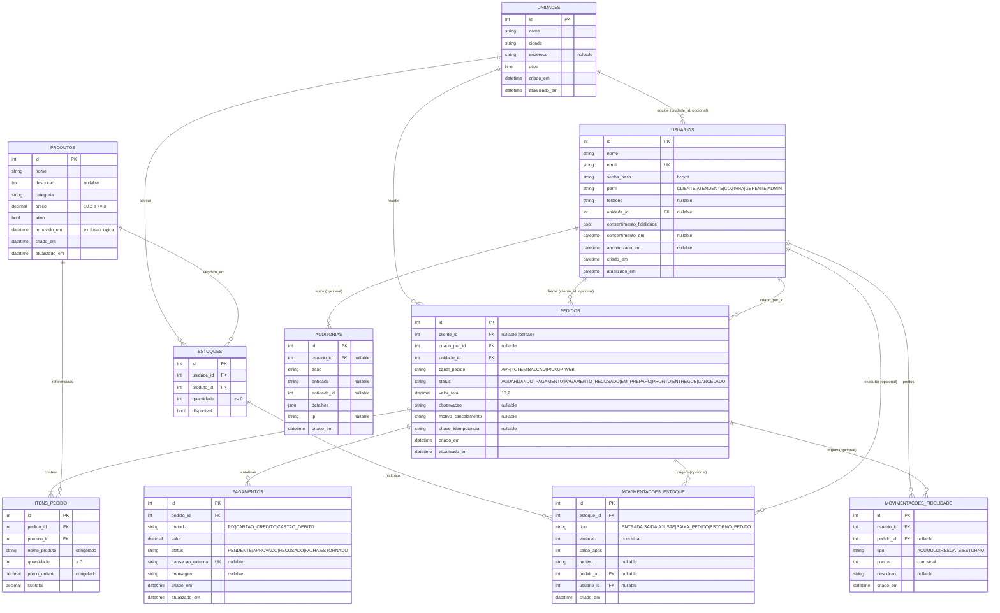

# DER — Raízes do Nordeste

Idêntico ao banco criado pela migration `alembic/versions/0001_esquema_inicial.py`. O teste
`tests/test_migrations.py` compara o banco migrado com os modelos (`app/infrastructure/db/models.py`) e
falha se houver qualquer divergência. O diagrama é Mermaid: renderiza direto no GitHub; para a entrega em
imagem/PDF, abra em <https://mermaid.live> e exporte como PNG ou SVG.



## Restrições relevantes (garantidas pelo banco, não só pela aplicação)

| Tabela | Restrição | Para quê |
|---|---|---|
| `usuarios` | `email` único; índice em `perfil` | um cadastro por e-mail |
| `estoques` | **único (`unidade_id`, `produto_id`)**; `CHECK quantidade >= 0` | cardápio por unidade; estoque nunca fica negativo |
| `pedidos` | **único (`criado_por_id`, `chave_idempotencia`)**; índices em `status`, `canal_pedido`, (`unidade_id`,`status`) | idempotência; listagens rápidas no pico |
| `itens_pedido` | `CHECK quantidade > 0`; preço e nome **copiados** do produto | histórico não muda se o preço mudar |
| `pagamentos` | **índice único parcial** (`pedido_id`) `WHERE status = 'PENDENTE'`; `transacao_externa` único | no máximo UM pagamento aguardando o gateway por pedido, mesmo com requisições simultâneas; o callback localiza a tentativa pela transação |
| `movimentacoes_fidelidade` | **único (`pedido_id`, `tipo`)** | no máximo um ACÚMULO e um ESTORNO por pedido |
| `produtos` | `CHECK preco >= 0`; exclusão lógica (`removido_em`) | pedidos antigos continuam resolvendo o produto |
| FKs de auditoria/movimentação/cliente | `ON DELETE SET NULL` | o histórico sobrevive à remoção do usuário |

O saldo de fidelidade é `SUM(pontos)` de `movimentacoes_fidelidade` do usuário (não existe coluna de saldo,
então ele nunca diverge do extrato).

## Como o estoque é protegido (decisão de projeto)

A baixa **não** é feita lendo o saldo e gravando o novo. É um único `UPDATE` condicional:

```sql
UPDATE estoques SET quantidade = quantidade - :q WHERE id = :id AND quantidade - :q >= 0;
-- linhas afetadas = 0  ->  estoque insuficiente (nada foi alterado)
```

Duas vendas simultâneas do último item não passam as duas: o banco serializa o `UPDATE` e a segunda afeta 0 linhas.
