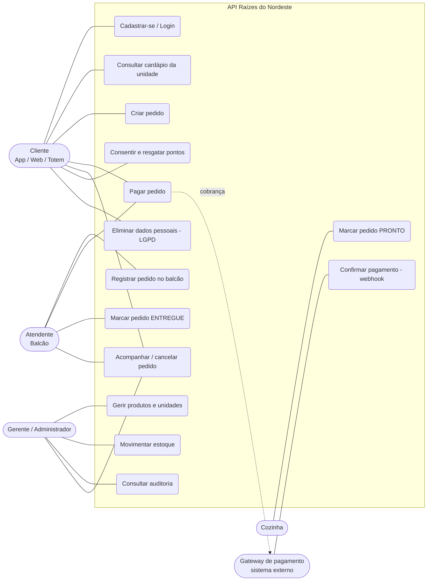
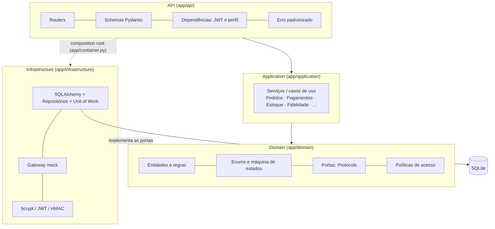
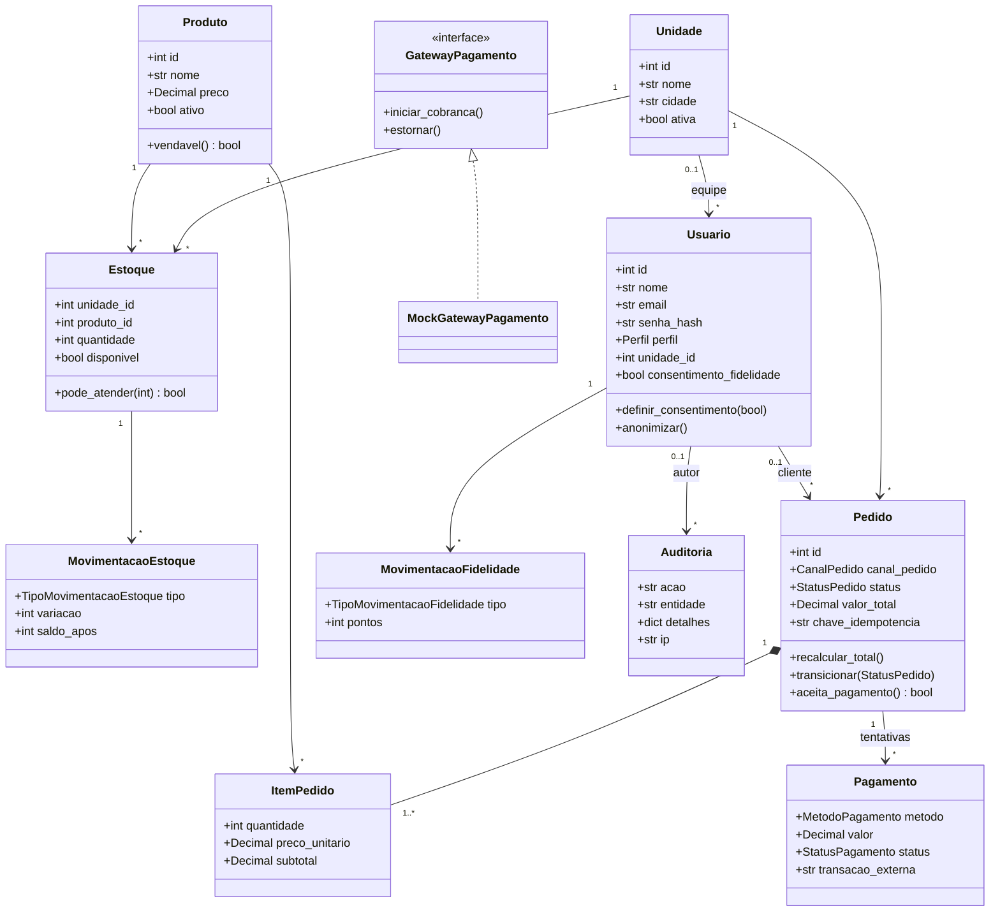
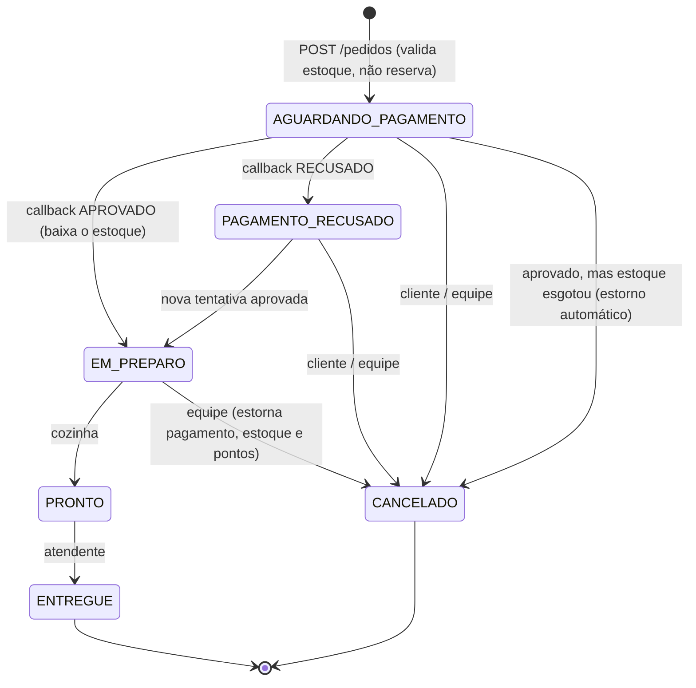
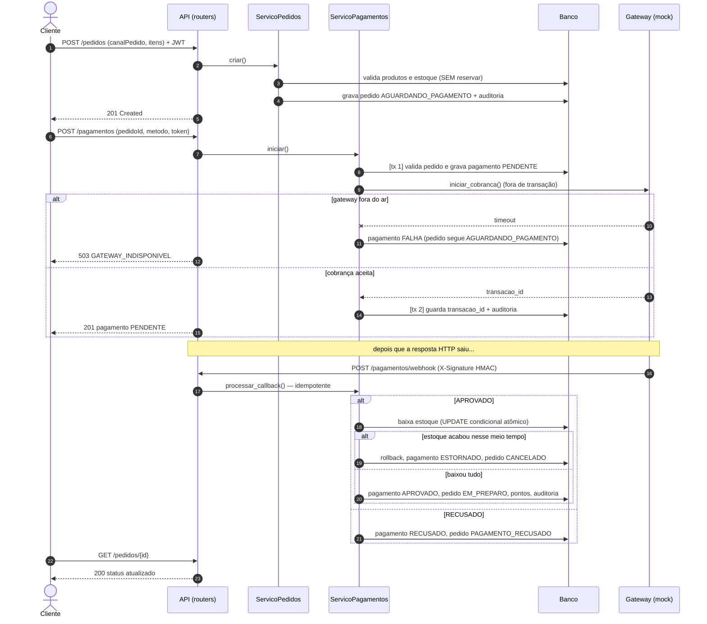

# Diagramas — Raízes do Nordeste

Todos em Mermaid (renderizam no GitHub). Para a entrega em imagem/PDF, abra em <https://mermaid.live>.

## 1. Casos de uso

## 2. Arquitetura em camadas

Regra de dependência: **Domain não importa nada**; Application só conhece Domain; Infrastructure implementa as
portas definidas no Domain; a API chama a Application. Só o `container.py` conhece as implementações concretas.

## 3. Diagrama de classes (domínio)

## 4. Máquina de estados do pedido

## 5. Sequência do fluxo crítico: pedido → pagamento externo assíncrono → status

